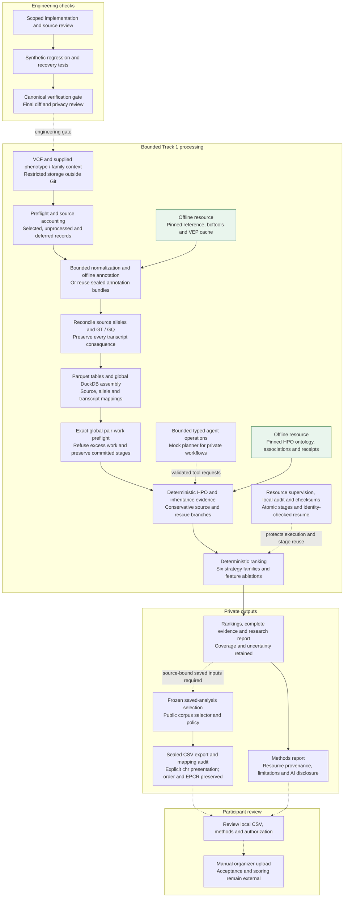

# Automated Open-Source Rare Disease AI Agent System

Local-first research software for **Track 1: rare-disease variant prioritization** in the
SageBio *Rare Disease, Real Kid: MVA Hackathon 2026*. The repository implements deterministic
VCF → Parquet → DuckDB processing, bounded agent control, phenotype and inheritance evidence,
auditable ranking, restartable local analysis, and a frozen hypothesis-selection and export policy.

The goal is to produce inspectable research hypotheses with their evidence, provenance and
uncertainties. Full variant tables and genotype evidence stay in local analytical stores; an
optional model receives only bounded tool summaries.

> **Research use only.** This is not a clinical diagnostic system or medical advice.
> A completed bounded run, a valid CSV, or a passing software test does not establish a causal
> variant, whole-case coverage, clinical accuracy, or organizer acceptance.

## Track 1 workflow and current scope

The processing and engineering controls below are implemented. Synthetic workflows are runnable
from this checkout without model weights or reference downloads. Bounded local analysis and a
local submission package have been prepared; their private contents and results are not published
here. This work remains limited to its selected source scope and resource limits. Final human
review and external upload are pending.



The diagram describes implemented responsibilities, not a claim that every branch has completed
for a whole case. The [reproduction guide](docs/track1-reproduction.md) connects the public source
preparation, annotation/corpus analysis, saved-result selection, and export commands. Exact input,
resource and historical configuration identities must still be supplied privately; code availability
does not establish that a complete raw-input replay has been performed. Exporting an existing
sealed selection does not reproduce upstream annotation, analysis or selection.
The [engineering work ledger](docs/subagents/README.md)
lists recorded delegated workers and their task labels; current verification status is established by
the local canonical gate, not by historical task summaries.

## Install and run a synthetic example

Python 3.11–3.13 is supported. From the repository root, create a development environment with
an installed supported interpreter; this example selects Python 3.13:

```bash
python3.13 -m venv .venv
.venv/bin/python -m pip install -e '.[dev]'
.venv/bin/pre-commit install
```

Installation installs Python dependencies. It does not fetch challenge inputs, reference
databases, annotation caches or model weights. For an existing environment, keep its interpreter
selection instead of creating another one. The examples below use `PYTHONPATH=src` to import this
checkout explicitly. The installed `rare-disease-agent` command exposes the same CLI.

Run a complete synthetic phenotype/inheritance case with the deterministic mock planner:

```bash
PYTHONPATH=src .venv/bin/python -m rare_disease_agent track1-synthetic \
  --case de-novo --backend mock --output-dir /tmp/rda-track1-synthetic
```

Choose a fresh output directory. The run writes ranking and evidence artifacts and reports
synthetic evaluation metrics. Its invented variants, genes, family and HPO associations test
software behavior; their results are not evidence of accuracy on real cases.

Other synthetic entry points exercise individual components, all available without live inference:

```bash
# Streaming VCF-to-Parquet preparation.
PYTHONPATH=src .venv/bin/python -m rare_disease_agent variants prepare \
  tests/fixtures/synthetic/variants.vcf.txt /tmp/rda-synthetic-variants.parquet

# Bounded, reversible agent-directed filtering.
PYTHONPATH=src .venv/bin/python -m rare_disease_agent agent-filter \
  --input synthetic --backend mock --output-dir /tmp/rda-synthetic-filter

# Restartable workflow with preflight, critic, evidence and local report.
PYTHONPATH=src .venv/bin/python -m rare_disease_agent track1-dry-run \
  --case missing-parent --output-dir /tmp/rda-track1-dry-run

# Offline synthetic benchmark suites.
PYTHONPATH=src .venv/bin/python -m rare_disease_agent benchmark-synthetic \
  --output-dir /tmp/rda-track1-benchmark
PYTHONPATH=src .venv/bin/python -m rare_disease_agent benchmark-phase4 \
  --output-dir /tmp/rda-track1-stress-benchmark --seed 17
```

The first suite covers de novo, recessive, compound-heterozygous, X-linked, incomplete-phenotype
and novel-gene cases. The later suite adds uncertainty and failure conditions such as missing
parents, incomplete penetrance, affected siblings, unphased pairs and missing annotations.
Use the identical `track1-dry-run` command to resume an unchanged run. A changed input, resource
or implementation requires a fresh run; committed artifacts are never silently regenerated.

## How the scientific processing works

**Representation and storage.** Streaming parsing and bounded Parquet writes retain source
alleles and genotype calls. The Phase 5 VEP importer stores all allele records and transcript
consequences, with a mapping from each allele/gene ranking candidate to its source and selected
representative consequence. A representative consequence is a scoring reduction, not deletion
of the other transcripts. DuckDB executes fixed parameterized queries, persists evidence and
branch membership, and streams complete outputs.

**Phenotype evidence.** HPO identifiers are validated against versioned resources, with supported
obsolete-term replacements retained in provenance. Resnik best-match-average similarity compares
the supplied terms with gene associations. Missing associations remain unknown and do not exclude
a candidate; conservative and novel-gene rescue behavior is preserved. Phenotype similarity is
conditional on the supplied phenotype information actually describing the analyzed individual.

**Inheritance evidence.** Typed genotype and pedigree inputs support dominant, recessive,
de novo, X-linked and compound-heterozygous hypotheses. Missing family calls, affected status,
quality measurements and phase remain explicit limitations. No sample identity, sex or parentage
is inferred. Possible or unknown trans phase is never promoted to confirmed trans without the
required parental evidence. These are inspectable compatibility heuristics, not pathogenicity
classifications.

**Ranking and sensitivity.** Quality, population rarity, consequence, phenotype and inheritance
features contribute to a configurable weighted linear score. Population frequency uses supported
gnomAD annotation fields; caller allele frequency is not a substitute. The bounded Phase 5 flow
provides baseline, phenotype-heavy, inheritance-heavy, pathogenicity-heavy, ensemble and
conservative strategies, alongside the default ranking and feature ablations. Their correlated
contexts measure sensitivity to feature/weight choices; they are not independent votes or
calibrated causal probabilities. Missing clinical or predictor annotations are never invented.

**Agent boundary.** LangGraph controls a bounded loop of schema-validated typed operations.
Deterministic code performs parsing, filtering, evidence computation, scoring and persistence.
Models receive compact summaries, have no arbitrary SQL or shell authority, and cannot bypass
tool, iteration or resource limits. Filters create new branches so earlier membership stays
inspectable. A bounded read-only critic can request re-inspection but cannot change scores or
expand the planner's budget. Authorized private workflows use the mock planner and no live model.

See [architecture](docs/architecture.md), [representation and integrity](docs/phase5-execution.md#integrity-and-representation),
and [scaling contracts](docs/phase5-scaling.md) for the precise algorithms and limits.

## Bounded annotation, corpus analysis and recovery

Private execution begins with explicit local authorization and prepared resources outside Git.
It does not follow automatically from running a synthetic example. The implementation provides
separate interfaces so that planning, annotation execution and analysis have distinct scopes:

| Interface | Implemented responsibility |
| --- | --- |
| `phase5 coverage-plan` | Account for source records and propose disjoint supported partitions, retaining unprocessed and deferred dispositions. |
| `phase5 coverage-materialize` | Materialize only the explicitly selected partitions, without annotation or ranking. |
| `phase5 coverage-batch` | Supervise a bounded requested batch of normalization, offline annotation, validation, assembly, pair preflight and global ranking; reuse explicitly pinned annotation bundles where supplied. |
| `phase5 corpus-run` | Reference sealed annotation bundles without copying them, validate with current code, assemble their ordered union and run one global analysis; no annotation execution. |
| `phase5 plan` / `phase5 run` | Preview and execute a bounded analysis from an existing verified annotation rehearsal or assembly. |
| `phase5 evaluate` | Compare existing artifacts against explicitly supplied local truth labels, with separate gene/allele retrieval and failure accounting. |

Coverage-batch and corpus analysis assemble evidence globally before ranking, including eligible
cross-shard pairs. They do not concatenate independent shard rankings. Exact pair-work admission,
memory, time and disk limits fail closed; a refusal preserves committed work and does not justify
dropping source candidates or raising a cap. The current bounded execution context does not
establish whole-genome coverage or general sex-chromosome/PAR support.

Stage journals bind input, resource, configuration and implementation identities. Evidence writes
are transactional and stage publication is atomic. Resume verifies committed checksums and
recomputes only interrupted, uncommitted work. Changed identity or corrupted committed artifacts
require a fresh output directory; editing an old journal to force reuse is unsupported.

For configuration schemas, authorization requirements and exact commands, use
[bounded execution](docs/phase5-execution.md), [coverage and corpus operations](docs/phase5-scaling.md),
and [local labeled-case evaluation](docs/case-evaluation.md). Resource locks, explicit acquisition,
offline import, HPO normalization and receipts are described in [resources](docs/resources.md).
Analysis commands do not install annotation tools or download a reference/cache to unblock a run.

## Frozen hypotheses, final CSV and methods

The [submission policy](scripts/track1_submission_policy.py) operates on already source-bound,
saved evidence in the frozen `filtering_phenotype_inheritance` order. It applies deterministic
singleton/pair rules, consumes each used endpoint, retains saved phase uncertainty and audits
unavailable or rejected hypotheses. Pair confidence is an ordering key, not a probability.
The policy's anchor and output bounds, tie handling and exact rules are documented in the
[methods template](docs/track1-methods-template.md).

The [public selector](scripts/track1_select.py) binds that policy to a pinned completed corpus.
It verifies the saved journal chain, recovers immutable source mappings and evidence, and emits
a sealed selection without new annotation, evidence computation or reranking. Copy the
[selector example](configs/track1-select.json.example) into restricted storage and supply authentic
local provenance, the recorded analysis commit, a trusted corpus-journal digest, and a fresh output:

```bash
PYTHONPATH=src .venv/bin/python scripts/track1_select.py --config /absolute/restricted/path/select.json
```

EPCR means *estimated probability of causal relationship*. The policy assigns an explicitly
subjective, uncalibrated geometric forecast by emitted row rank and leaves residual probability
for omitted or unmodeled explanations. It does not convert ranking scores into probabilities or
renormalize the selected rows to sum to one. The [policy source](scripts/track1_submission_policy.py)
and [methods template](docs/track1-methods-template.md#epcr-convention) specify the convention.

The final [exporter](scripts/track1_export.py) accepts an existing sealed selection containing
`draft.csv`, `audit.json`, `manifest.json` and `integrity_manifest.json`. It verifies the supplied
seal and draft/audit agreement, then applies an explicit chromosome presentation map: bare nuclear
primary-chromosome labels become their canonical `chr`-prefixed forms, and already canonical
labels remain unchanged. Unsupported labels are refused. This is not liftover or normalization.
Candidate order, positions, reference/alternate strings, EPCR strings, finding types and notes
are preserved.

Create a private configuration from [the export example](configs/track1-export.json.example),
using a previously verified source seal and a fresh output directory outside Git, then run:

```bash
.venv/bin/python scripts/track1_export.py --config /absolute/restricted/path/export.json
```

The exporter writes `submission.csv`, a mapping/provenance audit and a new integrity manifest
atomically, without rewriting its inputs. It performs no annotation, analysis, hypothesis
selection, EPCR allocation or upload. Reproducing this formatting stage requires the earlier
sealed artifacts. For the complete public code route and configuration examples, read
[bounded workflow reproduction](docs/track1-reproduction.md); for formatting alone, read
[export reproduction and limits](docs/track1-export.md). Neither code publication nor an export
comparison independently establishes exact private provenance or a complete upstream replay.

The separate [CSV validator](scripts/track1_validate.py) checks the local structural contract.
A format pass does not verify source binding, biological interpretation, coverage or official
submission readiness. The [dated organizer review](docs/organizer-evaluation-readiness.md)
records the public requirements inspected and their unresolved ambiguities.

Prepare the completed methods report outside Git from [the public template](docs/track1-methods-template.md).
Record the actual software/resource identities, coverage limits, configured affected/linkage
declarations, independently supported facts and remaining uncertainty. Disclose engineering and
scientific AI use accurately, including verified provider/tier/data-handling settings where
applicable. Include the organizer-prescribed acknowledgement outside the abstract. A configuration
flag is not independent biological confirmation. Human local review
of the CSV and report and manual organizer upload remain pending. Confirm disclosure authorization
before uploading; the pipeline does not claim an external submission or evaluation result.

## Privacy and local configuration

Keep restricted inputs, derived reports, candidate tables, audits, metrics and export packages
outside Git. A pseudonym or aggregate metric does not make patient-derived content public.
Public resource caches are separate from restricted inputs and private outputs. Remote
patient-data transfer is disabled by default, private workflows refuse enabled external tracing,
and no report is automatically transferred or submitted. Read [the privacy policy](docs/privacy.md)
and [restricted-data setup](data/README.md) before any authorized-data work.

| Configuration | Purpose |
| --- | --- |
| [`configs/default.yaml`](configs/default.yaml) | Validated paths, privacy settings, runtime bounds and preliminary scoring. |
| [`configs/scoring.yaml`](configs/scoring.yaml) | Explicit research score weights. |
| [`configs/models.yaml`](configs/models.yaml) | Shared local-model profile and backend-substitution examples. |
| [`configs/track1-coverage-plan.json.example`](configs/track1-coverage-plan.json.example), [`configs/track1-coverage-batch.json.example`](configs/track1-coverage-batch.json.example), [`configs/track1-corpus.json.example`](configs/track1-corpus.json.example) | Data-free templates for bounded source preparation, pinned offline annotation and corpus analysis. |
| [`configs/track1-select.json.example`](configs/track1-select.json.example), [`configs/track1-export.json.example`](configs/track1-export.json.example) | Private provenance pins and fresh destinations for saved-result selection and final CSV formatting. |
| [`.env.example`](.env.example) | Environment overrides and tracing settings. |

Nested overrides use the `RDA_` prefix and double underscores, for example
`RDA_PATHS__RESTRICTED_DATA_DIR`. Example configurations are not authorization to access or transfer
restricted data. Runtime paths and private configuration values must not enter issues or commits.

An optional loopback Ollama backend supports synthetic experiments with an already installed
model. Backend, model-size and live-memory checks run before inference; no weights are downloaded.
The hardware inspection commands are read-only and do not start a model:

```bash
PYTHONPATH=src .venv/bin/python -m rare_disease_agent models inspect-hardware
PYTHONPATH=src .venv/bin/python -m rare_disease_agent models recommend
```

The baseline development machine is Apple Silicon with 16 GB unified memory. The conservative
profile shares one local quantized model across roles. See [model selection](docs/model_selection.md)
for supported constraints; model substitution does not change deterministic scientific processing.

## Verify the checkout

Use the same explicitly selected existing interpreter for both commands, from the repository root:

```bash
make verify PYTHON=.venv/bin/python
make verification-status PYTHON=.venv/bin/python
```

The canonical gate checks that the package imports from this worktree, then runs the complete
synthetic test/coverage suite, Ruff lint and formatting checks, privacy scan, dependency
consistency, package builds and staged/unstaged whitespace checks. It installs nothing and does
not auto-fix files. Pause concurrent editing and run only one verifier at a time.

Only a **current canonical PASS** supports “fully verified.” Relevant content, index or HEAD
changes invalidate earlier evidence; the status command checks identity without rerunning tests.
Report FAIL, INCOMPLETE or STALE explicitly. `.verification/` evidence is local generated output
and must not be committed. Historical passes and synthetic benchmark results are not current
completion evidence or independent scientific validation.

Review the complete staged, unstaged and new-file diff as well as the automated results. The
privacy guard and `.gitignore` reduce disclosure risk but cannot prove that every public file is
free of private content. See [verification and completion evidence](docs/operations.md#verification)
and [the repository agent contract](AGENTS.md) for the authoritative workflow.

## Documentation and code map

| Start here | Contents |
| --- | --- |
| [`src/rare_disease_agent`](src/rare_disease_agent) | CLI, deterministic tools, storage, ranking, model boundary and workflows. |
| [`tests`](tests) | Deliberately synthetic unit, integration, failure and recovery coverage. |
| [Architecture](docs/architecture.md) | Component responsibilities, typed agent control and evidence design. |
| [Operations](docs/operations.md) | Synthetic runs, recovery, annotation previews and verification. |
| [Resources](docs/resources.md) | Pinned public provenance, explicit fetch/import and offline normalization. |
| [Execution](docs/phase5-execution.md) | Bounded integration, representation, stage integrity and private outputs. |
| [Scaling](docs/phase5-scaling.md) | Source coverage, annotation batches, corpus assembly and resource gates. |
| [Case evaluation](docs/case-evaluation.md) | Explicit truth binding, retrieval metrics and failed-case accounting. |
| [Methods template](docs/track1-methods-template.md) | Selection, subjective EPCR, evidence limitations and disclosures. |
| [Reproduction guide](docs/track1-reproduction.md) | Public commands, complete configuration examples and private provenance requirements from bounded source preparation to final CSV. |
| [Final export](docs/track1-export.md) | Required sealed inputs, chromosome mapping and reproduction limits. |
| [Engineering work ledger](docs/subagents/README.md) | Recorded engineering workers and runtime-role distinctions. |

Historical phase documents explain how the implementation developed. Their plans and recorded
results are context, not current verification, new authorization or claims of complete case analysis.

## License

[MIT](LICENSE). Reference resources and gated inputs retain their own terms.
